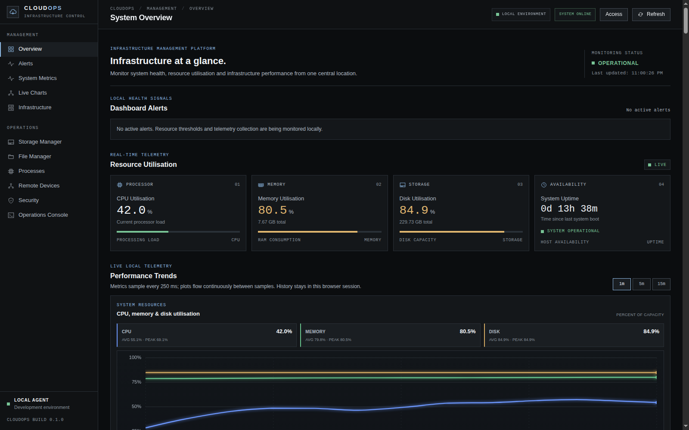
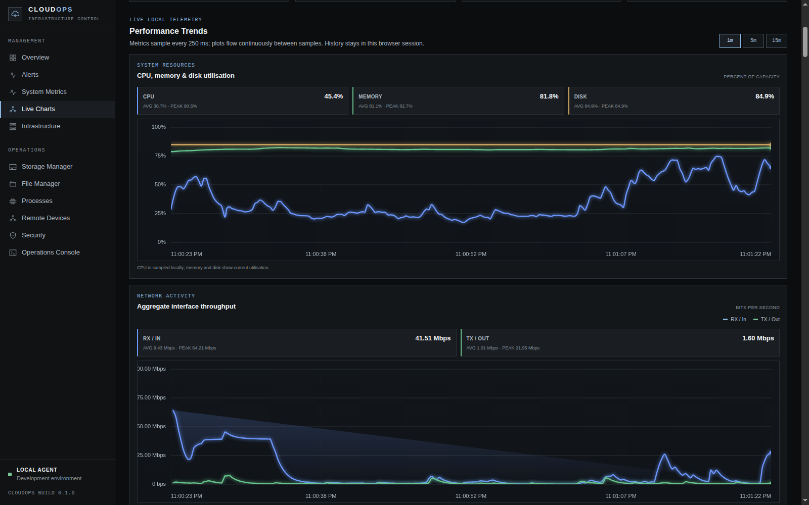

# CloudOps

CloudOps is a **learning project and portfolio piece** exploring Linux and
Windows system monitoring, a local operations dashboard, and consent-based
file exchange between paired devices. It is intended for learning and
experimentation, not as production remote-management or security software.

## Features

- Live CPU, memory, disk, network, and system health metrics
- Local storage, file preview, and process monitoring
- Fixed, read-only operations diagnostics
- Optional telemetry from paired devices over a private Tailscale network
- Explicitly approved file exchange between paired CloudOps installations

CloudOps runs as the signed-in user and does not elevate privileges or execute
arbitrary shell commands. Use it only on computers you own or are authorized
to administer. Do not expose the dashboard or agent ports to the public
internet.

## Screenshots

Captured from a local run. Live metrics shown are from the demo machine at the
time of capture.





## Requirements

- Python 3.10 or later
- Windows or Linux
- Tailscale on both devices for remote pairing and sharing

## Run locally

### Windows

Open PowerShell in the extracted project directory:

```powershell
py -3 -m venv .venv
.\.venv\Scripts\python.exe -m pip install -r requirements.txt
.\.venv\Scripts\python.exe app.py
```

### Linux

Open a terminal in the project directory:

```bash
python3 -m venv .venv
./.venv/bin/python -m pip install -r requirements.txt
./.venv/bin/python app.py
```

Open <http://127.0.0.1:5000>. On first use, choose the app-level permissions
you want. Operating-system permissions still apply. The Windows file manager
is scoped to the current user's profile; file access on both platforms is
limited by the signed-in account.

## Pair devices for telemetry

Install Tailscale on both computers and sign in to the same private tailnet.
On the device that will run the agent, generate a random agent key:

```text
python -c "import secrets; print(secrets.token_urlsafe(32))"
```

Keep the key private. On Windows, open PowerShell in the project directory,
set the key and bind the agent to that PC's Tailscale IPv4, then start it:

```powershell
$env:CLOUDOPS_AGENT_TOKEN = "PASTE_THIS_DEVICE_AGENT_KEY"
$env:CLOUDOPS_AGENT_BIND = (tailscale ip -4 | Select-Object -First 1).Trim()
.\.venv\Scripts\python.exe remote_agent.py
```

On Linux, use the same environment variables and command pattern:

```bash
export CLOUDOPS_AGENT_TOKEN="PASTE_THIS_DEVICE_AGENT_KEY"
export CLOUDOPS_AGENT_BIND="$(tailscale ip -4)"
./.venv/bin/python remote_agent.py
```

Allow inbound TCP port 8765 only from the other device's Tailscale IP. In
CloudOps, grant **Pair remote devices**, open **Remote Devices**, and pair the
agent using its Tailscale IPv4 and agent key. The agent reports system
telemetry; it does not offer remote shell, process control, or service control.

## Share files with approval

File sharing is opt-in and is separate from telemetry. Each computer needs its
own running agent and CloudOps dashboard. For each device:

1. Generate two different random secrets using the Python command above: an
   **agent key** and a **local approval key**.
2. Set `CLOUDOPS_AGENT_TOKEN`, `CLOUDOPS_AGENT_APPROVAL_TOKEN`, and
   `CLOUDOPS_AGENT_BIND` in the environment for both the agent process and the
   local dashboard process. The local approval key must stay on that device;
   never enter it on the other computer.
3. Allow inbound TCP port 8765 only from the peer's Tailscale IP.
4. On both CloudOps dashboards, grant **Pair remote devices** and **Share
   selected files**. Pair each computer from the other computer's dashboard
   using that peer's agent key.

Choose **Share file** on a paired device to send one selected file (maximum
10 MB). The receiving dashboard displays the offer and requires a local
approval or rejection. Offers are kept in memory for up to 10 minutes, with a
maximum of three pending offers. Approval saves a copy to
`~/CloudOps Shared/Received`; existing files are never overwritten and files
are not opened automatically. To share an edited version back, send the copy
in the opposite direction. CloudOps does not browse or edit remote files in
place.

Agent keys and device pairings are held in memory and must be re-entered after
the dashboard restarts. Pending offers are lost if the agent restarts. Rotate
an agent key on its device if it should no longer be trusted. Tailscale
provides the private network path; do not configure public port forwarding.

## Run tests

```bash
python -m pip install -r requirements.txt
python -m unittest discover -s tests -v
```

## Portfolio summary

CloudOps is a hands-on learning project focused on Python/Flask application
development, Linux and Windows system monitoring, dashboard UI, permission
boundaries, and private-network device pairing. The project is not a
production-ready management platform.

## License

See [LICENSE](LICENSE).
